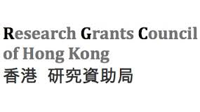
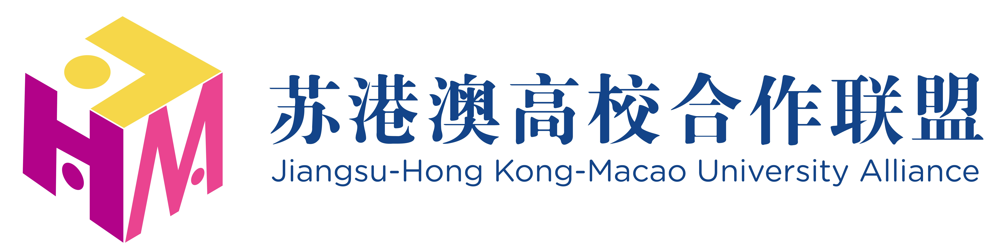

<link rel="stylesheet" href="{{ '/assets/css/a2hd.css' | relative_url }}">

  <header class="a2hd-intro">
    
    <h1>Adaptive AI &amp; Human Dynamics Lab 智動實驗室</h1>
    
We study human-centred AI at Lingnan University, combining machine learning with research on how people behave, interact, and make decisions. <a href="{{ '/rpgadmission' | relative_url }}">Join the lab</a>.

  </header>

  

  <section class="a2hd-directions" aria-labelledby="research-directions">
    <h2 id="research-directions">Research directions</h2>

    

      <h3>
        <i class="fas fa-users"></i>
        Human dynamics
      </h3>
      
We study how speech and interaction patterns reveal individual traits and group behaviour. We use nonlinguistic audio for personality profiling, study how groups form and move in public spaces, and model how personality shapes emotion in dialogue.

    

    

      <h3>
        <i class="fas fa-sliders-h"></i>
        Adaptive intelligence
      </h3>
      
We adapt language models to the user and the task. PeLA steers how a model expresses personality traits, MRM retrieves evidence in stages for questions that require multiple reasoning steps, and QAQ adjusts inference precision to the complexity of each query.

    

    

      <h3>
        <i class="fas fa-clipboard-check"></i>
        Domain-specific evaluation
      </h3>
      
We evaluate models on the tasks they will perform. LLM4Rail supports personalised railway services, AutoRepairBench tests automotive repair reasoning with models such as RepairLLM, and PreConfig automates network configuration. In CCC8015, we develop hints tailored to each student’s learning progress.

    

    

      <h3>d Privacy &amp; trust</h3>
      
Across our research, we study how models can unlearn trajectory data, how to watermark models trained through continuous prompt learning, and whether anonymous LLM sessions can be linked to the same person. In education, we compare AI-generated feedback across students to assess bias.

    

    
Explore our <a href="{{ '/projects' | relative_url }}">projects</a> and <a href="{{ '/publications' | relative_url }}">publications</a>.

  </section>

# Lab Members

### Director
- Dr. Shen Jiaxing

### Staff
- [Dr. Zhou Yuzhi](https://www.ln.edu.hk/sds/dai/division/people/professor-zhou-yuzhi), Research Assistant Professor

### PhD Students
- Mr. Shen Yifei (25 intake)
- Mr. Wang Wenxuan (25 intake)
- Ms. Liu Zirui (25 intake)
- Mr. Kou Haoxuan (25 intake)
- Mr. Li Shuxing (26 intake)
- Mr. Liu Xinpeng (26 intake)
- Mr. Bian You (26 intake)
- Mr. Zuo Chenyu (27 Spring intake)
- Mr. Wang Haopeng (27 Spring intake)

### Research Assistants
- Mr. Zuo Chenyu

### UG Students
- Mr. Wu Ruiqing (26 intake)

### Alumni & Collaborators
- [Dr. Miao Hao](https://haomiao.website/) (now Research Assistant Professor at The Hong Kong Polytechnic University)
- [Mr. Zhao Haihong](https://haihongzhao.com/) (now PhD at HKUST)
- Mr. Shen Yifei (now PhD at LU)
- Mr. Gu Zepeng (now PhD at HKU)
- Mr. Liu Yuanjun (visiting Phd from Soochow University)
- Mr. Cheng Zhenkai

### Open Positions  
- **PhD students**: 3 quotas for 2027 Fall intake
<!-- - **Postdoctoral fellows**: 1 quota left -->

<section class="support-section">
  <h2>Acknowledgements</h2>
  
We gratefully acknowledge support from UGC, JHMUA, Lingnan University, The Hong Kong Polytechnic University, and 雲伽.

  

    
    
    
    
    
    
  

</section>
